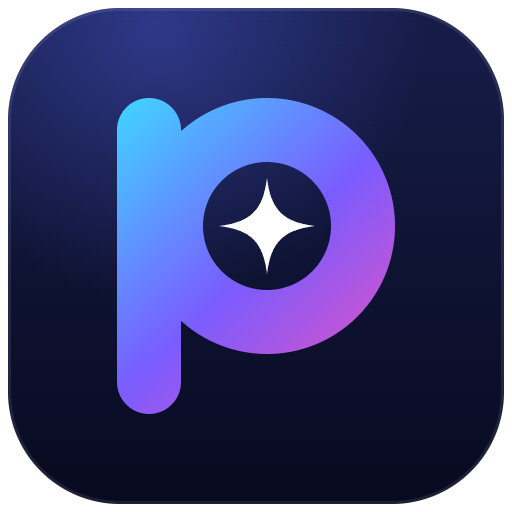

<p align="center">
  
</p>

<h1 align="center">POLYMIRA</h1>

<p align="center"><b>Every console. One universe.</b></p>

<p align="center">
  A controller-first, PS3-style console frontend that turns your Windows PC into a game console.<br/>
  All your games — Steam, Epic, Xbox app, emulators — in one place, played from the couch.
</p>

<p align="center">
  <a href="https://github.com/hasanlior/polymira/releases/latest"></a>
  <a href="https://github.com/hasanlior/polymira/releases"></a>
  <a href="https://github.com/hasanlior/polymira/stargazers"></a>
  
</p>

<p align="center">
  <a href="https://github.com/hasanlior/polymira/releases/latest"><b>⬇ Download</b></a> ·
  <a href="#features">Features</a> ·
  <a href="#supported-platforms">Platforms</a> ·
  <a href="#controls">Controls</a> ·
  <a href="README.tr.md">Türkçe</a>
</p>

> POLYMIRA does **not** include or distribute games, BIOS, firmware or keys. Only use backups of software you own.

## Download

1. Grab **`POLYMIRA-Setup-x.y.z.exe`** from the [latest release](https://github.com/hasanlior/polymira/releases/latest) (or the portable `.exe` if you don't want to install).
2. Run it. Windows SmartScreen may warn because the app is not code-signed yet: click **More info → Run anyway**.
3. The first-run wizard scans your PC for games and emulators and can download emulators for you.

POLYMIRA updates itself from GitHub Releases.

## Features

**Console experience**
- **XMB-style interface** — horizontal categories, vertical lists, animated wave background, menu sounds, smooth transitions.
- **Full controller support** — Xbox, DualShock 4, DualSense, Switch Pro and generic pads, plus keyboard. Button hints show the right symbols for the controller in use (A B X Y, ✕ ○ □ △, Nintendo layout). Every button can be remapped.
- **In-game menu** on the controller's Guide button (or Back + Start, or `Ctrl + Shift + Home`): resume, real pause (the game process is suspended), screenshot, quick save / load (RetroArch), back to home, quit game, live CPU / RAM / GPU stats.
- **PS3-style ambience** — focusing a game fades in its artwork, plays its official trailer (Steam) and theme music.
- **Notifications** — PS3-style cards for downloads, trophies, backups and updates, also shown over running games.
- **Console-style shutdown** — the screen fades out, cleanup steps are shown, then the app closes (also on Alt+F4).

**Your whole library in one place**
- **PC scan** finds installed games wherever they are: **Steam**, **Epic Games**, **Xbox app / PC Game Pass**, **GOG**, **Riot Games**, **Ubisoft Connect**, **EA app**, **Battle.net**, Rockstar and other installs, plus emulators and ROM folders.
- Store games launched through their launchers are still tracked, so the in-game menu and play time work for them too.
- **Automatic artwork** — covers and backgrounds from the games themselves, Steam, the Epic launcher cache and libretro-thumbnails. No API keys.
- **Game info pages** — description, year, genre, developer and screenshots (Steam store, libretro database, Wikipedia).
- **Trophies** — Steam achievements read from Steam's own files; RetroAchievements for emulated games. Unlocks pop up while you play.
- **Play statistics** — last 7 days chart, weekly and total time, most played games.

**POLYMIRA Orbis — our own PS4 core (experimental)**
- Orbis reads PS4 executables, lists the system functions a game needs and shows how many of them it already implements (**Orbis analysis** on PS4 / PS5 games).
- It loads and starts PS4-format executables, binding system calls to its own native implementations. Commercial games do not run yet; see [emu/orbis](emu/orbis/README.md) for the roadmap.

**Emulation that just works**
- **One-click emulator downloads** from official sources (RetroArch with cores, DuckStation, PCSX2, PPSSPP, RPCS3, Vita3K, shadPS4, xemu, Xenia, Cemu, melonDS, Azahar, Flycast) — in the background, with progress and time left.
- **Automatic controller setup** — controller settings are written into the emulator before the game starts, so nobody has to open the emulator.
- **Save data management** for every emulator — automatic backups after each session, one-click restore, optional sync folder (OneDrive, Google Drive, USB).
- **Per-game settings** — emulator choice, RetroArch video filters (CRT, LCD, sharp) and extra arguments.
- **Honest compatibility** — every platform is marked Stable / Experimental / Unsupported, and each game shows its last launch result.

**Apps, store and customization**
- **Built-in browser, YouTube (TV UI) and Twitch** run inside the console, with a controller pointer and on-screen keyboard. Netflix, Disney+, Prime Video and Spotify are supported too (Widevine).
- **Full-screen store** for apps, emulators, themes and mods; a [community catalog](community/README.md) lets anyone publish themes and mods.
- **Themes and CSS mods**, English and Turkish interface.

**Game mode and reliability**
- While you play: high CPU priority, High performance power plan (only when you are on Balanced / Power saver), optionally closes the Windows desktop shell — everything is restored afterwards.
- The console stays behind the game, so the desktop never flashes between game and menu.
- A small watchdog restores the desktop and restarts the app after a crash.

## Supported platforms

| Family | Platforms | Emulators |
| --- | --- | --- |
| PlayStation | PS1, PS2, PSP · PS3, Vita, PS4 (experimental) | DuckStation, PCSX2, PPSSPP, RPCS3, Vita3K, shadPS4 |
| Xbox | Xbox, Xbox 360 (experimental) | xemu, Xenia Canary |
| Nintendo | NES, SNES, N64, GB, GBC, GBA, DS, 3DS, GameCube, Wii, Wii U, Switch | RetroArch, melonDS, Azahar, Dolphin, Cemu, Ryujinx |
| Sega | Master System, Mega Drive, Saturn, Dreamcast, Game Gear | RetroArch, Flycast |
| Other | Arcade, Neo Geo, Atari 2600 / 7800 / Lynx, MSX, Commodore 64 | RetroArch |
| PC | Steam, Epic, Xbox app, GOG, Riot, Ubisoft, EA, Battle.net, `.exe`, `.lnk`, `.url` | — |

Platforms without a working emulator (PS5, Xbox One / Series) are shown as unsupported, never faked.

## Controls

| Button | Action |
| --- | --- |
| D-pad / left stick | Navigate |
| A / ✕ | Select |
| B / ○ | Back |
| Y / △ | Options |
| X / □ | Gallery view |
| LB / RB | Switch category |
| Guide, or Back + Start | In-game menu |

Keyboard: arrows, `Enter`, `Esc`, `T` (options), `G` (gallery), `Q` / `E` (category), `Ctrl + Shift + Home` in game.

## Building from source

Requirements: Windows 10/11, Node.js 20+.

```bash
npm install
npm run dev        # development
npm run typecheck  # type check
npm run dist       # installer + portable exe in release/
```

Built with Electron (castlabs build with Widevine), React and TypeScript. POLYMIRA Orbis is written in Rust (`emu/orbis`); `npm run dist` builds it when Rust is installed.

## Known limitations

- The in-game menu appears over games running in **borderless full screen**; exclusive full screen games may hide it.
- Netflix and other DRM services play inside the console only in VMP-signed builds; otherwise they open full screen in Microsoft Edge.
- Cemu, Ryujinx, melonDS and Azahar need their controller set up once in the emulator.
- Dolphin and Ryujinx have no stable download link and must be installed manually (they are detected automatically).

## License

POLYMIRA is **source-available** under the [PolyForm Strict License 1.0.0](LICENSE):

- ✅ Download and use POLYMIRA for noncommercial purposes.
- ✅ Read the code, report bugs, suggest features, contribute to the community store.
- ❌ Redistributing the app or the code, or publishing modified versions or projects based on it, is not allowed.
- ❌ Commercial use requires permission.

Contributions are accepted under the same license.

POLYMIRA is not affiliated with Sony, Microsoft, Nintendo, Sega or Valve. Platform names are trademarks of their owners and are used only to describe compatibility.

---

<p align="center">⭐ If POLYMIRA is useful to you, a star helps a lot!</p>
